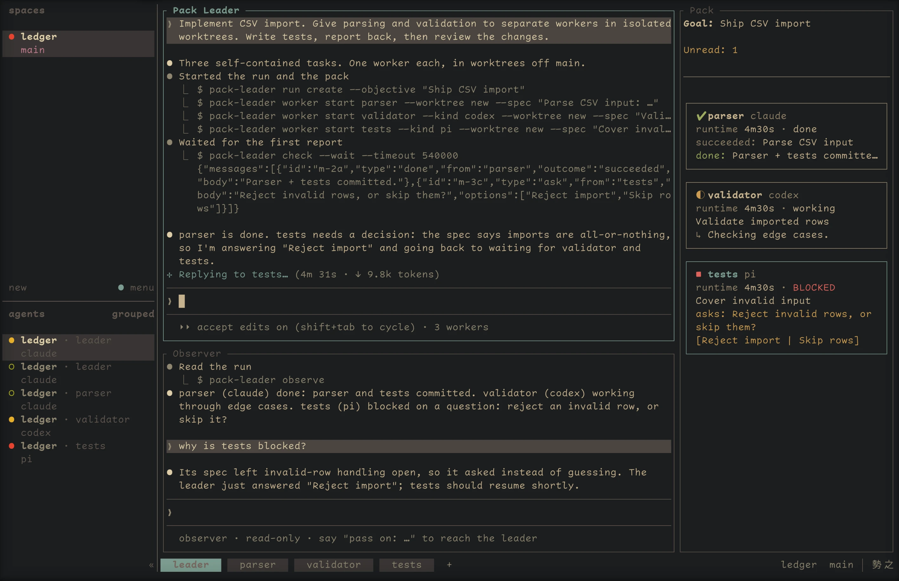
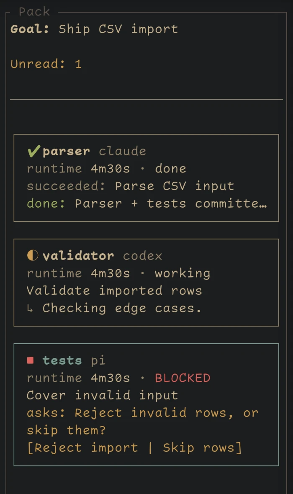

### Pack Leader

Pack Leader is an independent [herdr](https://github.com/herdrdev/herdr) plugin that lets your
coding agent coordinate a team of **Claude Code, Codex or pi** workers. The
coordinator delegates tasks, answers questions and collects reports. Workers
run in their own tabs or splits; a live sidebar keeps the whole run visible.

Tasks, messages and dispatch history live outside the agents' context windows.
Inspect assignments, current attempts and reports—even after a worker's tab closes.

[Full guide](docs/guide.md) · [Command reference](docs/guide.md#commands) · [Changelog](docs/CHANGELOG.md)



*The leader tab of a run: Pack Leader, the Observer and the Pack sidebar. A real herdr session with staged demo data, not a capture of private sessions.*

## Install

Requires **herdr 0.9+**, **Node.js 22.18+**, and an installed, authenticated
agent CLI. Supported platforms: Linux and macOS.

```bash
herdr plugin install zenodea/pack-leader
herdr plugin action invoke install-skill --plugin pack-leader
```

This installs the skill for configured Claude Code, Codex and pi environments,
and links `pack-leader` into `~/.local/bin`. Keep that directory on your `PATH`;
run orchestration commands inside herdr.

## Usage

Tell your agent what to delegate:

> Implement CSV import. Give parsing and validation to separate workers in
> isolated worktrees. Have them write tests, review their reports, then integrate.

The skill guides the agent through the workflow. You can also use the CLI:

```bash
pack-leader run create --objective "Implement CSV import"
pack-leader worker start parser --worktree new \
  --spec "Implement CSV parsing and its tests; commit changes and report results."
pack-leader worker start validator --worktree new \
  --spec "Implement row validation and its tests; commit changes and report results."
pack-leader check --wait --timeout 540000
```

A run opens a sidebar and an **observer agent** for progress questions; skip
these with `--no-sidebar` or `--no-observer`. The observer reads run state and
recent coordinator turns. `pack-leader say "…"` sends your instructions to the
coordinator.

Keep checking until every task has an explicit outcome. Answer questions with
`reply MESSAGE_ID --body "…"` and acknowledge messages with `check --ack MESSAGE_ID`.
After reviewing the work, reuse a worker with `worker prompt`, retain its pane
with `worker retain`, or release it:

```bash
pack-leader worker release parser
pack-leader worker release validator
pack-leader run close
```

Worktree branches survive release. **Review and merge them separately:** Pack
Leader coordinates the work; it does not automatically merge branches or verify
an agent's claims.

## What you can do

| Capability | How it works |
| --- | --- |
| **Plan work** | Tasks carry specs, titles and outcomes. Use `--depends-on` for ordering, `worker start --retry` for failed tasks, and `--parent` / `task tree` for hierarchy. Parent links are not dependencies. |
| **Require approval** | `gate create --task TASK_ID --reason "…"` blocks dispatch. Resolve with `gate resolve GATE_ID --decision approve\|reject`. Decisions are durable, coordinator-owned and immutable—not worker questions. |
| **Choose agents** | `config pick` or `config set` sets defaults. Override `--kind`, `--model` and `--thinking` per worker; pass native agent arguments after `--`. |
| **Isolate changes** | `--worktree new` creates a branch and checkout; `--worktree PATH` reuses one. `--base` / `--branch` customize new checkouts. Ordinary `--cwd` execution needs no Git repository. |
| **Prepare checkouts** | `--setup-command "npm ci"` runs before a local worktree agent launches, with bounded logs and `--setup-timeout` in milliseconds. Failure blocks launch; reuse does not rerun setup. |
| **Adopt sessions** | `worker adopt NAME --spec "…"` attaches to an existing named idle/done local agent without restarting it. `--target-pane` disambiguates names. Release never closes adopted sessions. |
| **Send followups** | Address one worker, `@all`, `@idle` or a kind such as `@pi`. Delivery waits for readiness or `inbox`; `--now` requests immediate delivery. Workers can message same-run peers. |
| **Supervise explicitly** | Workers use `ask` (optionally with choices), `note`, `heartbeat` and `done --outcome succeeded\|failed`. Status shows liveness, attention and next actions. Idle is not completion. |
| **Audit handoffs** | `dispatch list` and `dispatch show ID --preamble` expose attempts and exact instructions. Outcomes carry summaries, changed-file lists and report paths; release archives screens for later `worker read`. |
| **Run remotely** | SSH host profiles route launch, messaging, observation and release while keeping run state on the leader. See [Remote workers](#remote-workers). |

## Supervision



*The Pack sidebar. A worker question shows its choices. Demo data.*

```bash
pack-leader status --json                         # current run, tasks and workers
pack-leader status --all                          # fleet overview, including closed runs
pack-leader worker read parser                   # live screen or archived output
pack-leader worker focus parser                  # open its tab
pack-leader worker stop parser                   # interrupt; not a completion report
pack-leader send @all "Report test commands and results."
pack-leader observe --turns 6                     # run digest and recent coordinator turns
pack-leader run prune --dry-run                   # preview record and checkout cleanup
```

Use `--run RUN_ID` to select a run. Most commands return JSON; help, the skill,
live screens and terminal status are human-readable. Unknown flags are rejected
before state changes.

In the sidebar, click a worker to select it; **Enter** or a second click opens
its tab. Press **`o`** in the sidebar or run `pack-leader leader` to return to the
coordinator. Selection follows herdr's accent colour. Workers use hidden tabs
by default; `--placement split` places one beside you instead.

<details>
<summary>Optional: keyboard shortcuts and Claude Code permissions</summary>

Add shortcuts to herdr's `config.toml`:

```toml
[[keys.command]]
key = "prefix+alt+w"
type = "plugin_action"
command = "pack-leader.sidebar"
description = "Pack Leader: show the pack"

[[keys.command]]
key = "prefix+a"
type = "plugin_action"
command = "pack-leader.focus-leader"
description = "Pack Leader: back to the leader"
```

To avoid repeated CLI permission prompts for a Claude Code coordinator, add
this rule to its existing `~/.claude/settings.json` permissions:

```json
{ "permissions": { "allow": ["Bash(pack-leader:*)"] } }
```

New Claude Code workers receive this rule by default.

</details>

## Remote workers

Both machines need Pack Leader, herdr and Node, plus an existing remote herdr
workspace and working directory. Configure non-interactive SSH **in both
directions** with trusted host keys: the leader launches workers; workers call
back with reports and questions.

```bash
pack-leader host add buildbox --ssh-target buildbox --workspace-id w1 \
  --leader-ssh-target laptop
pack-leader worker start remote-tests --host buildbox --cwd /srv/project \
  --spec "Run the test suite and report failures; do not modify files."
```

Substitute your SSH aliases, workspace ID and path. Manage profiles with
`host list`, `host show` and `host remove`; existing workers retain their original
settings. Custom executable/socket paths are covered in the [guide](docs/guide.md#commands).

Remote placement currently supports **existing directories and tab placement**,
not remote worktree creation, setup hooks or agent adoption. A lost connection
marks the host unreachable rather than failing its tasks. SSH access is a trust
boundary; delivery receipts are heuristic, not exactly-once guarantees. Remote
regressions use fake SSH/socket transport; live end-to-end SSH remains unverified.

## State and cleanup

- **State:** atomic, lock-protected records normally live under
  `~/.local/state/herdr/plugins/pack-leader/`. Records survive context compaction;
  an agent's full memory does not.
- **Release:** closes only owned panes/tabs and removes clean Pack-created
  worktrees, preserving branches. `--keep-worktree` retains the checkout.
  Dirty, existing and potentially still-in-use checkouts are protected.
- **Shutdown:** `run close` refuses unfinished workers. `--release` releases
  them and fails unfinished tasks—it does not wait for reports. Close/prune
  clean up eligible checkouts and old records/archives; five closed runs are
  kept by default.
- **Trust:** worktrees isolate Git changes, not permissions. Setup commands run
  with your access; escaped descendants can outlive a timeout.

For lifecycle rules, recovery procedures and every option, use
`pack-leader help` or `pack-leader skill`, or read the [full guide](docs/guide.md).

## Develop

```bash
npm ci
npm test              # typecheck + tests; no live herdr or SSH required
herdr plugin link .   # use this checkout as the installed plugin
```

Node runs the TypeScript directly; there is no build step.

## License and credits

[MIT](LICENSE). The orchestration skill's supervision loop, task-spec contract
and completion accounting were adapted from [Orca](https://github.com/stablyai/orca)
(MIT), rewritten for herdr's panes, tabs and agents. The user-supplied mascot image
is separate from the code licence.
