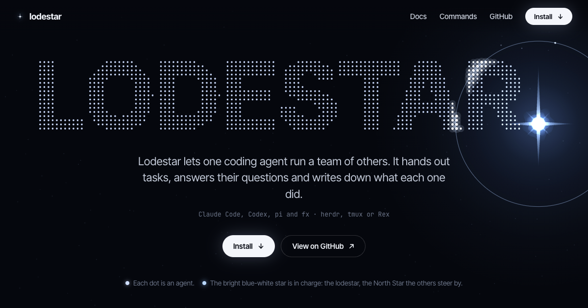

# Lodestar

Lodestar lets one coding agent run a team of others. You talk to a single agent, the
leader. It splits your request into tasks, starts a crewmate agent for each one,
answers their questions, reads their reports and merges the results.

- **Agents:** Claude Code, Codex and pi, as the leader or as crewmates, in any mix; Vercel fx as a crewmate.
- **Terminals:** runs inside [herdr](https://herdr.dev), tmux or Rex.
- **Memory:** tasks, specs, every attempt and every report live in a state file
  outside the agents, so a cleared session or a closed tab loses nothing.

A lodestar is the star you steer by. Here it's the leader.

[Website](https://zenodea.github.io/lodestar/) ·
[Docs](https://zenodea.github.io/lodestar/docs/) ·
[Commands](https://zenodea.github.io/lodestar/docs/?p=commands) ·
[Changelog](docs/CHANGELOG.md)

## Install

You need Zig 0.17 (the binary builds itself on first run), an agent CLI you're
logged into, and Linux or macOS.

On **herdr** 0.9 or later:

```sh
herdr plugin install zenodea/lodestar
herdr plugin action invoke install-skill --plugin lodestar
```

On **tmux** 3.x:

```sh
git clone https://github.com/zenodea/lodestar
cd lodestar
bin/lodestar skill --install
```

Both install the skill for every Claude Code, Codex and pi setup they find, and
link `lodestar` into `~/.local/bin`. Keep that on your `PATH`.

## Use it

Ask your agent for the work and say you want it split up:

> Implement CSV import. Give parsing and validation to separate crewmates in isolated
> worktrees. Have them write tests, review their reports, then integrate.

The skill takes it from there. Behind the scenes the leader runs commands like these,
and you can run them yourself too:

```sh
lodestar run create --objective "Implement CSV import"
lodestar crew start parser --worktree new --spec "Parse CSV input. Add tests. Report back."
lodestar crew start validator --worktree new --spec "Validate rows. Add tests. Report back."
lodestar check --wait --timeout 540000
```

Crewmates ask when they're stuck (`ask`), leave notes (`note`), raise problems
(`escalate`) and finish with `done`. The leader answers with `reply`, follows up
with `send`, and when the reports are in it checks the work, merges the branches
and closes the run.

While it runs:

- `lodestar status` shows the run, its tasks and crewmates.
- `lodestar crew read parser` prints a crewmate's screen, live or saved.
- `lodestar say "Leave the docs for last."` passes a message to the leader without
  interrupting it.
- On herdr, a **Crewmates** sidebar shows one box per crewmate, and a second agent,
  the **Navigator**, answers your questions about the run.

[Your first run](https://zenodea.github.io/lodestar/docs/?p=quickstart) walks through
a whole one.

## What it does and doesn't do

| It does | It doesn't |
| --- | --- |
| Give each crewmate one task with a written spec | Take a crewmate's "done" as proof; the leader checks |
| Put crewmates in their own Git worktrees and branches | Sandbox anything; worktrees separate Git changes, not permissions |
| Hold tasks until an approval gate says yes | Merge on its own; the leader merges, or leaves it to you if you ask |
| Hand the leader to a fresh session when its context fills up | Forget a run when a session or tab goes away |

More in the docs: [tasks and gates](https://zenodea.github.io/lodestar/docs/?p=tasks),
[worktrees](https://zenodea.github.io/lodestar/docs/?p=worktrees),
[handoffs and sub-runs](https://zenodea.github.io/lodestar/docs/?p=long-runs),
[tmux](https://zenodea.github.io/lodestar/docs/?p=tmux),
[remote crewmates](https://zenodea.github.io/lodestar/docs/?p=remote),
[model routing](https://zenodea.github.io/lodestar/docs/?p=model-routing).

## Coming from Pack Leader

Lodestar used to be called Pack Leader.

- **Moves on its own:** on its first run, `lodestar` moves your old state and settings
  folders to their new names.
- **Reinstall the skill:** `lodestar skill --install` installs the new skill and removes
  the old `pack-leader` skill and command link.
- **On herdr:** install the `lodestar` plugin and remove the old `pack-leader` one.
- **Renamed:** environment variables now start with `LODESTAR_` instead of `PACK_`.
- **New branches:** they're named `lodestar/<run>/<crewmate>`; old `pack/...` branches
  stay as they are.

## Develop

```sh
zig build -Drelease   # builds zig-out/bin/lodestar
zig build test        # unit tests; no live herdr, tmux or SSH needed
herdr plugin link .   # use this checkout as the installed herdr plugin
```

Lodestar is one native binary written in Zig. Sources are in `zig/`; `bin/lodestar`
rebuilds the binary whenever a source file is newer than it. The agent-facing guide
the skill loads is [`docs/guide.md`](docs/guide.md); the website and the user docs are
in [`site/`](site/).

## License and credits

[MIT](LICENSE). The supervision loop, task-spec contract and completion accounting in
the skill were adapted from [Orca](https://github.com/stablyai/orca) (MIT).
